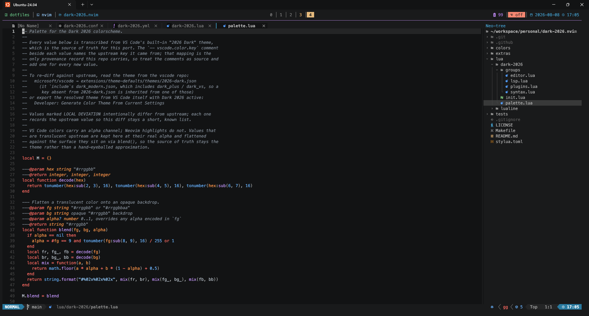

# dark-2026.nvim

A Neovim port of **Dark 2026**, the theme bundled with Visual Studio Code.

Near-black surfaces (`#121314` editor, `#191a1b` panels), a teal/steel-blue
accent (`#3994bc`), and GitHub-Dark-derived syntax colors. Hand-transcribed from
the upstream theme rather than machine-converted, so every value is deliberate
and every value is traceable — each one names the VS Code key it came from.



*Neo-tree, bufferline and lualine themed alongside the editor; tmux via
[`extras/`](extras/).*

## Requirements

- Neovim 0.10+ (developed against 0.12)
- A terminal with true-color support; the theme sets `termguicolors` itself

## Install

### lazy.nvim

```lua
{
  "boonyarit-iamsaard/dark-2026.nvim",
  lazy = false,
  priority = 1000,
  config = function()
    require("dark-2026").setup({
      -- transparent = true,
    })
    vim.cmd.colorscheme("dark-2026")
  end,
}
```

With **LazyVim**, let the distro apply the colorscheme instead:

```lua
{
  {
    "boonyarit-iamsaard/dark-2026.nvim",
    lazy = false,
    priority = 1000,
    config = function()
      require("dark-2026").setup({})
    end,
  },
  { "LazyVim/LazyVim", opts = { colorscheme = "dark-2026" } },
}
```

### packer / paq / vim-plug

Nothing special — install the repo, then `:colorscheme dark-2026`. Call
`setup()` first if you want to change an option.

> [!IMPORTANT]
> **`setup()` must run before the colorscheme is applied.** `:colorscheme
> dark-2026` builds and applies the highlights immediately, so options set
> afterwards have no effect until the next `:colorscheme` call. The specs above
> get this right: `priority = 1000` with `lazy = false` runs `config` before the
> colorscheme is set. If you change options at runtime, re-apply with
> `vim.cmd.colorscheme("dark-2026")`.

## Configuration

Defaults shown; `setup()` is optional and only needed to change one of these.

```lua
require("dark-2026").setup({
  -- Clear the background on full-window surfaces so the terminal shows through.
  -- Floats and popups keep their backgrounds so they stay legible.
  transparent = false,

  italic_comments = true,

  -- Last-word override hook, applied after everything else. `hl` is the full
  -- highlight table, `p` the palette.
  on_highlights = function(hl, p)
    hl.Comment = { fg = p.fg_disabled, italic = false }
    hl.CursorLine = { bg = p.bg_line }
  end,
})
```

### lualine

Works with no configuration — lualine's `theme = "auto"` finds
`lua/lualine/themes/dark-2026.lua` via `vim.g.colors_name`. To be explicit:

```lua
require("lualine").setup({ options = { theme = "dark-2026" } })
```

## API

```lua
-- Build the highlight table without applying it. Useful for deriving a theme
-- for another plugin, or for inspecting what a group resolves to.
local hl, palette = require("dark-2026").highlights()

-- The palette itself, including the 16 ANSI slots and the blend helper.
local p = require("dark-2026.palette")
p.accent            --> "#3994bc"
p.ansi.bright_blue  --> "#3b8eea"
p.blend(p.accent, p.bg, 0.2) --> flatten a translucent color onto a backdrop
```

`:colorscheme dark-2026` also sets the 16 `vim.g.terminal_color_*` slots, so
`:terminal` matches.

## Plugin support

Themed and used daily: gitsigns, neo-tree, snacks (including the picker),
bufferline, noice, which-key, trouble, flash, todo-comments, blink.cmp, mini.\*,
lazy.nvim, mason, grug-far, render-markdown, copilot, lualine.

Themed but **unverified** — written to the same rules, but not eyeballed in a
live session, so corrections are welcome: telescope, fzf-lua, nvim-cmp,
indent-blankline, dashboard-nvim, alpha-nvim.

Sections in [`lua/dark-2026/groups/plugins.lua`](lua/dark-2026/groups/plugins.lua)
are the authoritative list.

## Extras

tmux, lazygit and lazydocker ports of the same palette live in
[`extras/`](extras/).

## Where this differs from upstream

Two values are deliberately darker than VS Code's, because guides and line
numbers that read as subtle in a GUI editor compete with the code in a terminal.
Both are marked `LOCAL DEVIATION` in `palette.lua` with the upstream value
recorded beside them.

| VS Code key | Upstream | Here |
| --- | --- | --- |
| `editorIndentGuide.background1` | `#8384854d` | `#1f1f1f` |
| `editorRuler.foreground` | `#848484` | `#1f1f1f` |
| `editorLineNumber.foreground` | `#858889` | `#474747` |
| `editorIndentGuide.activeBackground1` | `#838485` | `#474747` |

The first is translucent and resolves to about `#343536` over the editor
background. The first two are `M.indent` in the palette, the last two
`M.fg_gutter`.

If you want the upstream values, override them without forking:

```lua
require("dark-2026").setup({
  on_highlights = function(hl, p)
    hl.LineNr = { fg = "#858889" }
    hl.IndentLine = { fg = p.blend("#838485", p.bg, 0.3) }
    hl.SnacksIndent = { fg = p.blend("#838485", p.bg, 0.3) }
    hl.SnacksIndentScope = { fg = "#838485" }
  end,
})
```

Everything else in the palette was checked value-by-value against
`2026-dark.json` and matches exactly.

## Contributing

The palette is the source of truth. Two rules keep it that way:

1. **Every palette value keeps its `-- vscode.color.key` comment.** The upstream
   theme file is not vendored into this repo, so those comments are the entire
   provenance record and the only way to re-diff against upstream. Add one for
   any new value; never strip them.
2. **No hardcoded hex outside `palette.lua`.** Group files take the palette and
   return a table; if you need a color that is not in the palette, add it to the
   palette with its key.

Translucent upstream colors are kept at their real alpha and flattened against
whatever surface they sit on via `blend()`, rather than being pre-baked into a
hand-picked hex. Keep it that way — it means a change upstream is a one-line
change here.

To re-diff against upstream, read
[`extensions/theme-defaults/themes/2026-dark.json`](https://github.com/microsoft/vscode/blob/main/extensions/theme-defaults/themes/2026-dark.json)
in the vscode repo. It `include`s `dark_modern.json`, which includes
`dark_plus.json` and `dark_vs.json`, so a key absent from `2026-dark.json` is
inherited from one of those. Alternatively, export the resolved theme from VS
Code itself with Dark 2026 active, via **Developer: Generate Color Theme From
Current Settings**.

A handful of values intentionally differ from upstream and are marked
`LOCAL DEVIATION` in `palette.lua`, each recording the upstream value it
replaces. That list is meant to stay short.

Run the checks before opening a PR:

```sh
make check  # stylua --check .
make test   # smoke test against the current nvim
```

CI pins [StyLua](https://github.com/JohnnyMorganz/StyLua) to **2.5.2**, so install
that version locally if a formatting diff surprises you. It also runs
`markdownlint-cli2` over the docs and the smoke test against Neovim v0.10.4 (the
advertised minimum), stable, and nightly — see
[`.github/workflows/ci.yml`](.github/workflows/ci.yml).

### Two notes on the transcription

**The Dark+ layer is dead code upstream.** `2026-dark.json` stacks a
GitHub-Dark-derived `tokenColors` ruleset *after* an older Dark+ ruleset. VS Code
resolves ties in favour of the later rule, so the Dark+ values (`#569cd6`,
`#ce9178`, …) never actually render. They are deliberately not reproduced here.
Please don't "fix" this.

**Symbol icons come from the color registry, not the theme.** `symbolIcon.*` and
`editorInlayHint.*` are not set in the theme file at all — VS Code's built-in
defaults supply them. They are reproduced in the palette so completion menus keep
the same kind colors as VS Code, and labelled as such.

## Credits

A port of **Dark 2026**, a default theme in the
[Visual Studio Code source repository](https://github.com/microsoft/vscode),
used under that repository's MIT license. Colors are transcribed from
[`2026-dark.json`](https://github.com/microsoft/vscode/blob/main/extensions/theme-defaults/themes/2026-dark.json);
no upstream file is redistributed here. See [NOTICE](NOTICE).

Not affiliated with or endorsed by Microsoft.

## License

[MIT](LICENSE). Upstream attribution is in [NOTICE](NOTICE).
